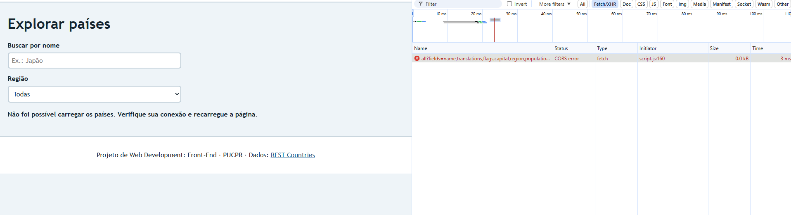
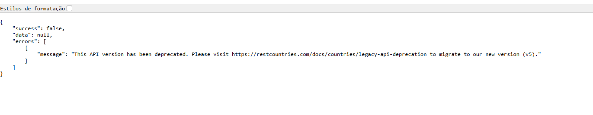
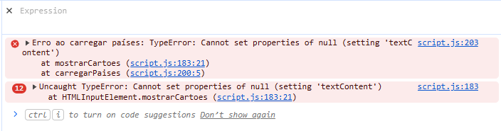
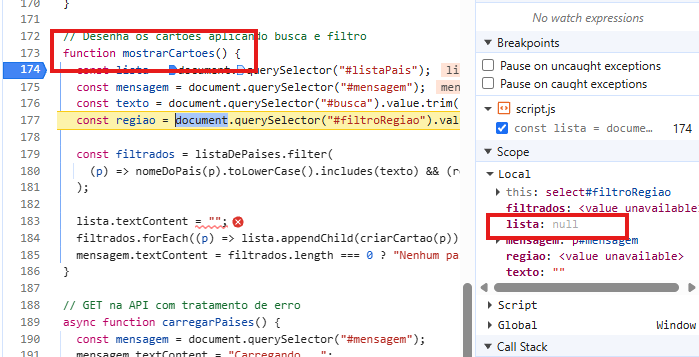
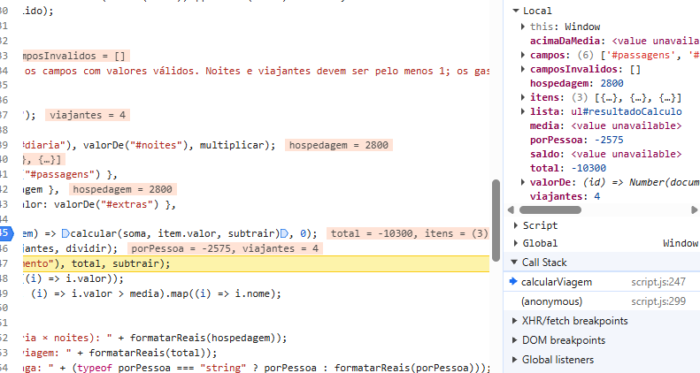
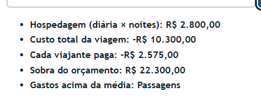

# Mundo em Viagem

Site para pesquisar países e calcular o custo de uma viagem.

# Integrantes

- Felipe Portella Mendes 
- Pedro Henrique Gabardo Igeski
- Victor Alves da Luz
- Vitor Marczak da Silva

## API

- GET: `https://restcountries.com/v3.1/all?fields=name,translations,flags,capital,region,population,currencies,cca3`
- POST: `https://jsonplaceholder.typicode.com/posts` (formulário de contato; resposta simulada)

## TDE 01 — Funções

| Função | O que faz |
|---|---|
| `somar(a, b)` | Soma dois valores. |
| `subtrair(a, b)` | Subtrai dois valores. |
| `multiplicar(a, b)` | Multiplica dois valores. |
| `dividir(a, b)` | Divide; avisa se o divisor for zero. |
| `calcular(a, b, operacao)` | Executa uma operação recebida como callback. |
| `calcularMedia(numeros)` | Calcula a média de um array. |
| `filtrarPor(lista, condicao)` | Filtra um array usando uma condição. |
| `formatarReais(valor)` | Formata um valor em reais. |
| `calcularViagem()` | Lê os campos da calculadora e mostra os resultados. |
| `mostrarEstatisticas()` | Calcula estatísticas dos países favoritos. |

As funções são usadas na página/aba **Ferramentas**.

## TDE 02 — Debugging

Bugs e erros que teve ao decorrer do projeto:

### Bug 1 — Erro da API

Inicialmente iriamos usar a API REST Countries, mas de prontidão ao testar retornou erro.
Ao entrar no link novo indicado pela API e pesquisando sobre, a nova versão requer autenticação.

Pesqsuisamos e usamos a api rest.

### Bug 2 — Erro ao criar cartões (DOM)

Os países não estavam carregando ainda, mesmo depois de trocar e validar a API. Após o breakpoint e mensagem de erro do console, vimos o nome errado de listaPais, sendo o correto listaPaises

### Bug 3 — Erro na soma

As lógicas para a ferramenta de dividir os custos estavam certa, exceto no uso da chamada de função. Duplicamos o subtrair, oq fez apresentar valores negativos no valor para cada pessoa, o que não faz sentido algum.

